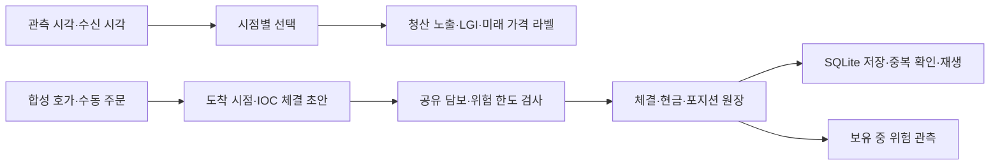

# Market Microstructure Toolkit

청산 노출 연구에서 출발한 Python 프로젝트입니다.
**당시 사용할 수 있었던 정보로 계산하고, 주문 체결·공유 담보·위험 상태·현금 원장의 일관성을 검증합니다.**

기존 Liquidation Gravity 연구의 일부를 독립 패키지로 재구성했습니다.
공개 입력은 모두 합성 데이터(`SYNTHETIC_TEST_ONLY`)이며 외부 API나 자격 증명 없이 실행합니다.

## 5분 안에 확인하기

Python 3.11 이상, 저장소 루트에서 실행합니다.

```bash
python3 -m venv .venv
source .venv/bin/activate
python -m pip install -e '.[dev,historical]'

python examples/portfolio_case.py
python scripts/verify_project.py
```

대표 사례는 주문 거부 → 담보 해제 → 가격 변화의 위험 관측 → 청산 → 원장 복구를 연결합니다.
한 번의 실행에서 임시 SQLite DB를 만들고 종료 시 정리합니다.
전체 검증 명령은 테스트·공개 예제·로컬 문서 링크·의존성을 검사하며 건너뛴 테스트도 실패로 처리합니다.

## 대표 결과

초기 현금 1,000, 수수료 0과 사람이 미리 정한 주문을 사용하는 합성 사례입니다.

| 시점 | 사건 | 확인할 결과 |
|---|---|---|
| 1초 | BTC long 5개 진입 | equity 995, 예약 담보 505 |
| 2초 | ETH long 50개 진입 시도 | 예상 equity 945 < 필요 담보 1,055 → 거부 |
| 4초 | BTC 일부 청산 후 ETH 신규 진입 | 현금 1,016, equity 993, 담보 여유 140 |
| 5초 | ETH 가격 하락 | equity 593, 예약 853 → 담보 여유 -260 기록 |
| 6·7초 | 미리 정한 ETH·BTC 청산 주문 | 최종 현금 540, 실현 손익 -460, 보유 수량 0 |
| 재열기 | 커밋 이벤트 재생·동일 이벤트 재전달 | 복구 현금 540, 중복 재반영 없음 |

가격 경로와 주문은 손계산용 인공 입력이며 전략 수익성이 아닙니다.
위험 관측은 자동 청산을 일으키지 않습니다.
[사례의 입력·계산·코드·테스트](docs/CASE_STUDY.md)를 함께 확인할 수 있습니다.

## 구조와 검증 근거



| 설계 판단 | 구현 근거 |
|---|---|
| 늦게 받은 정보를 과거 판단에 사용하지 않음 | [시점별 선택](src/market_microstructure/asof.py), [시간 경계 테스트](tests/test_asof.py) |
| 검사 통과 후에만 비용·포지션·호가 잔량 반영 | [실행 엔진](src/market_microstructure/execution.py), [체결·원장 테스트](tests/test_execution.py) |
| 자료 부재를0으로 바꾸지 않고 위험 근거 기록 | [위험 평가](src/market_microstructure/execution_risk.py), [보유 중 관측 테스트](tests/test_execution_monitor.py) |
| 이벤트와 원장을 함께 저장하고 중복은 재반영하지 않음 | [저널](src/market_microstructure/execution_journal.py), [강제 종료·복구 테스트](tests/test_execution_journal.py) |

연구 예제는 `python examples/research_walkthrough.py`로 실행합니다.
LGI의 가격 효과·관측 상태 효과·상호작용을 분리하며, LGI를 매매 신호로 변환하는 전략은 연결하지 않았습니다.

## 합성 주문 생명주기 — v2 첫 단계

```bash
python examples/order_lifecycle.py
```

별도 가상 거래소에서 접수 응답 유실 → 조회 복원 → 부분 체결 중 취소 요청 → 추가 체결 → 취소 확정을 다룹니다.
취소 응답이 체결 응답을 추월해도 누적 체결5개·현금 흐름-497을 한 번만 반영합니다.
미응답 주문을 자동 재전송하지 않으며 늦은 접수 응답이 종료 상태를 되돌리지 않습니다.
[상태·프로토콜·손계산·검증 범위](docs/ORDER_LIFECYCLE.md)를 확인할 수 있습니다.
이 모듈은 메모리 로그 재생까지이며 기존 담보·위험 검사·SQLite 저장과의 통합은 다음 단계입니다.

## 범위와 재현성

계산 코어는 표준 라이브러리, 테스트는 pytest, 선택적인 Parquet 처리는 PyArrow를 사용합니다.
macOS Python 3.11.6·3.13.15에서 검증했습니다. Linux는 아직 실행 검증하지 않았습니다.
[검증 기록](docs/development/PLAN.md)에 실행 환경과 단계별 결과가 있습니다.

이 프로젝트는 합성 선형 계약의 오프라인 실행·원장 검증과 별도 가상 주문 상태 처리입니다.
실제 거래소 연결·주문 전송·정정, 호가 대기열·시장 충격·펀딩·강제청산은 구현하지 않았습니다.
v2의 ACK·취소·미응답 대사는 직접 정의한 합성 누적 상태 프로토콜에 한정됩니다.
저널 복구는 동결 입력의 완료 이벤트와 계정 원장을 대상으로 합니다.
LGI의 실제 예측력·시장 전체 청산 확률·거래 수익성은 공개 검증 결과에 포함되지 않습니다.

## 상세 문서

- [대표 사례](docs/CASE_STUDY.md): 하나의 입력으로 보는 체결·위험·복구
- [실행 계약](docs/EXECUTION.md): 수량·비용·담보·설정 한도·위험 관측
- [저장과 복구](docs/JOURNAL.md): 원자적 저장·중복·재생 범위
- [합성 주문 생명주기](docs/ORDER_LIFECYCLE.md): 부분 체결·취소 경쟁·미응답 조회·중복/지연 보고
- [연구 계산](docs/RESEARCH.md), [코드 학습](docs/LEARNING.md)
- [출처·AI 보조·라이선스 상태](PROVENANCE.md)

설계·구현·테스트·문서에 AI 보조를 사용했습니다. 원본의 실제 자료와 비공개 결과는 배포하지 않습니다.
현재 LICENSE 파일은 추가하지 않았습니다.
