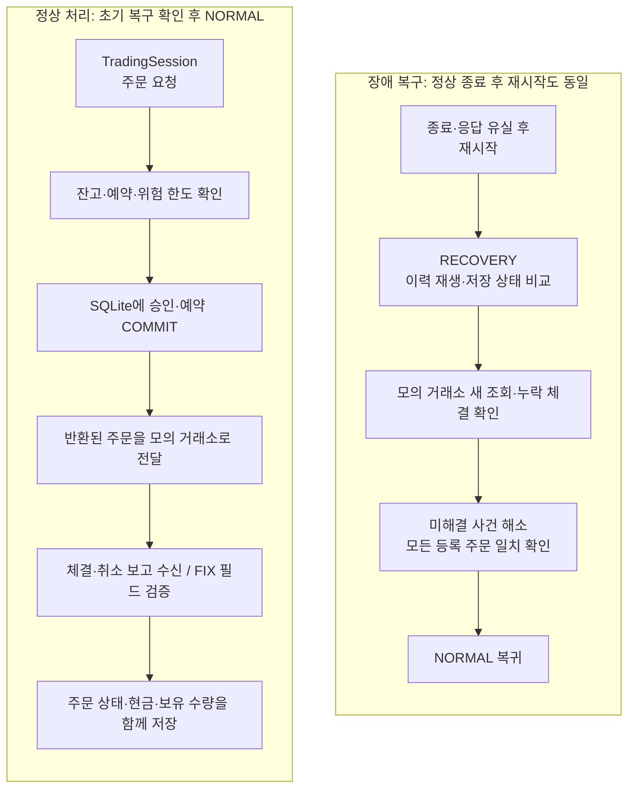

# Order Management System (OMS) Simulator

주문 취소 중 체결이 발생하거나 프로그램이 종료되면, 내부 주문 상태와 실제 처리 결과가 달라질 수 있습니다.
이 프로젝트는 **주문 상태와 현금·보유 수량을 일관되게 관리하고, 장애 후 모의 거래소와 비교해 복구하는 Python OMS 시뮬레이터**입니다.
주문·체결·취소 처리, 자금 예약, SQLite 저장, 제한된 FIX 4.4 업무 필드 변환을 구현했습니다.
실제 거래소 연결과 상용 운영 성능은 검증 범위에 포함하지 않습니다.

## 주요 구현

| 해결할 문제 | 구현한 처리 |
|---|---|
| 주문 중복·상태 혼동 | 신규·부분 체결·완전 체결·취소·거부 상태 관리, 보고 ID와 체결 ID 검증 |
| 같은 자금으로 여러 주문 | 매수 현금·매도 재고 예약, 사용 가능 잔고·시세 유효 시간·노출 한도 검사 |
| 취소 요청 중 추가 체결 | 취소 요청과 완료를 분리하고, 추가 체결을 반영한 뒤 확인된 잔여 예약만 해제 |
| 중복·역순 체결 보고 | 같은 체결의 중복 회계 반영 방지, 기존 사실과 충돌하는 보고는 상태 변경 없이 거부 |
| 장애·응답 유실 | 명령·결과·상태를 SQLite에 함께 저장하고, 재시작 시 전체 이력을 재생해 검산 |
| 거래소와 내부 상태 차이 | 모의 거래소 조회와 비교하는 대사(reconciliation), 미해결 사건 추적·신규 위험 제한 |

## 정상 처리와 장애 복구



취소 요청은 주문 종료가 아닙니다. 미응답·조회 부재만으로 주문을 실패 처리하거나 예약을 풀지 않습니다.
`RECOVERY`·`RESTRICTED`에서는 신규 매수를 제한하고, 기존 보고 반영·가능한 취소·조회·보유 재고 내 매도는 허용합니다.
자동 재전송·타이머·외부 알림 전송은 제공하지 않습니다.

## 설치와 실행

Python **3.11+**, macOS/Linux가 필요합니다. 계산 코어는 표준 라이브러리를 사용하며, 전체 검증에는 pytest와 PyArrow가 필요합니다.
API Key·계좌·시장 데이터 없이 아래 명령을 실행할 수 있습니다.

```bash
git clone https://github.com/Min9s/liquidation-aware-market-microstructure-research.git
cd liquidation-aware-market-microstructure-research
python3 -m venv .venv
source .venv/bin/activate
python -m pip install '.[dev,historical]'
python examples/fix_order_recovery.py
python scripts/verify_project.py
```

대표 데모는 초기 현금 1,000에서 `10@100` 매수 주문 → `4@99` 체결 → 취소 요청 중 `3@100` 추가 체결 → 잔여 3 취소 응답 유실 → 클라이언트 SIGKILL → 복구·대사를 실행합니다.
최종 **현금 304 / 보유 7 / 체결 7 / 취소 3 / 예약 0**을 독립 Decimal 계산과 비교합니다.
직접 생성한 자식 프로세스만 종료하며 임시 DB를 정리합니다. 수동 체결·수수료 0의 결정론적 합성 시나리오입니다.

## 검증 결과와 보장 범위

전체 검증 스크립트는 **637개 테스트(skip 0), 공개 예제 19개, 로컬 문서 파일 링크, 설치 의존성**을 확인합니다.
테스트만 실행하려면 `python -m pytest -q`를 사용합니다.

| 검증 | 확인하는 내용 |
|---|---|
| 보고 순서 24개 × 재시작 경계 5개 | 중복·역순 전달과 재시작 후 동일한 최종 주문·회계 상태 |
| 커밋 전후 강제 종료·실제 SIGKILL | 명령·체결·예약 상태의 부분 저장 방지와 복구 |
| 매 단계 독립 회계 검산 | 현금 = 사용 가능 현금 + 예약 현금, 체결 합계와 보유 수량 일치 |
| 새 조회·누락 체결·잘못된 필드 | 미해결 상태에서 정상 복귀 차단, 충돌 사실의 무변경 거부 |
| 실행 소유권 | 협력 POSIX API를 쓰는 두 번째 실행 프로세스 배제 |

이는 테스트한 합성 입력·로컬 SQLite·지원 API 범위의 검증입니다.
[회계 불변식·설계 감사](docs/ENGINEERING_AUDIT.md), [실행 근거](docs/OPERATIONAL_EVIDENCE.md),
[기존 Linux CI 실행 기록](https://github.com/Min9s/liquidation-aware-market-microstructure-research/actions/runs/42443254307)을 확인할 수 있습니다.
과거 v0.2.0의 589개 테스트·15개 예제 기록과 현재 결과는 구분합니다.

## 파일 구조와 코드 읽기 순서

```text
src/market_microstructure/
  trading_session.py      # 지원 실행 진입점·프로세스 소유권·시작 시 복구
  order_lifecycle.py      # 주문·취소 상태와 중복·역순 보고
  funded_orders.py        # 주문 승인·자금 및 재고 관리
  order_reservations.py   # 예약·잔고·위험 한도 계산
  funded_journal.py       # SQLite 원자적 저장·전체 이력 재생
  oms_operations.py       # 대사·Incident·운영 모드
  fix_adapter.py          # FIX 업무 필드 변환·검증·누락 체결 보류
  synthetic_fix.py        # 수동 체결을 제공하는 모의 거래소
examples/                 # 대표 복구 데모와 기능별 실행 예제
tests/                    # 회계·경합·장애·복구·입력 검증
scripts/                  # 전체 검증·벤치마크
benchmarks/               # 조건·환경·원시 측정값
docs/                     # 기능 계약·설계·학습 문서
```

**추천 순서:** [대표 데모](examples/fix_order_recovery.py) → [주문 상태](src/market_microstructure/order_lifecycle.py) → [자금 관리](src/market_microstructure/funded_orders.py) → [저장](src/market_microstructure/funded_journal.py) → [FIX·복구 테스트](tests/test_fix_adapter.py).
지원 진입점은 `TradingSession.create/open(journal_type=FixJournal)`입니다. 저수준 journal 직접 호출은 실행 소유권 보호를 우회하며, `_record`·`_verify`와 내부 dict는 안정적인 확장 API가 아닙니다.

기존 시장미시구조 연구·파생계약 IOC 예제도 같은 저장소에 보존되어 있습니다. 현금 OMS와 독립된 경로이며 전략 신호나 회계를 연결하지 않았습니다.
[학습 안내](docs/LEARNING.md)에서 현재 OMS와 기존 연구 코드의 읽기 경로를 구분합니다.

## FIX 범위와 한계

- FIX 4.4 **태그/값 객체**의 신규 주문(35=D), 체결 보고(35=8), 취소 요청(35=F), 종료 주문의 제한된 취소 거부(35=9), 명시적 상태 조회를 지원합니다. 주문 정정(35=G)은 제외합니다.
- ExecType과 OrdStatus를 구분하고 CumQty·LeavesQty·AvgPx·Trade ExecID를 검산합니다. 누락 체결을 평균가격으로 만들어내지 않습니다.
- FIX wire protocol·Logon·Heartbeat·sequence·Resend/Gap Fill·socket 재접속은 없습니다. Python fixture archive 재전달은 FIX Resend가 아닙니다.
- 단일 통화·수수료 0·차입 및 공매도 금지의 현금 계정입니다. 체결 정정과 실제 계좌 전체 대사는 미구현입니다.
- 소유권 보호는 협력 POSIX 프로세스·로컬 경로에 한정됩니다. 직접 DB 쓰기·분산 fencing·Windows/NFS는 보장하지 않습니다.
- 코드 해시가 바뀐 DB는 거부합니다. 자동 이관·로그 회전·전원 손실·대규모 운영은 미검증입니다.
- 전체 이력 재검산 비용은 이력과 함께 증가합니다. [조건별 벤치마크·원시값](docs/ENGINEERING_AUDIT.md)에 로컬 측정과 한계를 보존했으며 실거래 latency·throughput·HFT 성능으로 해석하지 않습니다.

## 상세 문서

[주문 상태](docs/ORDER_LIFECYCLE.md) · [회계](docs/ORDER_FUNDING.md) · [저장·복구](docs/DURABLE_ORDERS.md) ·
[FIX 필드 계약](docs/FIX_ADAPTER.md) · [운영·대사](docs/OMS_OPERATIONS.md) · [영문 소개·면접](docs/PORTFOLIO_INTERVIEW.md) ·
[기존 연구](docs/RESEARCH.md) · [IOC 사례](docs/CASE_STUDY.md) · [출처·AI 보조 사용](PROVENANCE.md)

비공개 원본 데이터·결과는 배포하지 않습니다. 현재 LICENSE 파일은 없으며 공개 소스 포트폴리오입니다.
