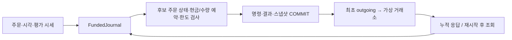

# Market Microstructure Toolkit — Synthetic OMS v2

**주문 응답이 유실되거나 프로세스가 강제 종료돼도 주문·현금·보유 수량·예약이 일치하는지 검증하는 Python 프로젝트입니다.**
청산 노출 연구에서 출발해 합성 주문 생명주기와 SQLite 복구 경로를 추가했습니다.
공개 입력은 모두 `SYNTHETIC_TEST_ONLY`이며 API 키·거래소 계정·비공개 데이터 없이 실행합니다.
패키지 `0.2.0`의 릴리스 준비본입니다. [검토 결과와 통합 조건](docs/development/RELEASE_V2.md)을 함께 제공합니다.

## 설치하고 대표 사례 실행하기

Python 3.11 이상, macOS 또는 Linux의 저장소 루트에서 실행합니다. 강제 종료 데모는 POSIX 전용입니다.

```bash
python3 -m venv .venv
source .venv/bin/activate
python -m pip install '.[dev,historical]'

python examples/durable_order_recovery.py --crash
python scripts/verify_project.py
```

계산 코어는 표준 라이브러리만 사용합니다. 전체 검증을 위해 pytest와 선택적 Parquet 의존성인 PyArrow도 설치합니다.
데모는 임시 SQLite DB를 사용하고 종료 시 정리합니다. `--crash`는 데모가 생성한 자식 클라이언트만 강제 종료합니다.

## 대표 시나리오: 응답 유실과 SIGKILL 복구

초기 현금1,000, buy10@limit100, 수수료0의 수동 합성 사례입니다.
부모 프로세스의 가상 거래소는 유지하고, 취소 경쟁 중 클라이언트만 `SIGKILL`로 종료합니다.

| 출력 단계 | 주문 / 취소 상태 | 현금 | 예약 현금 | 사용 가능 현금 | 로컬 보유 |
|---|---|---:|---:|---:|---:|
| `committed` — 승인·예약 저장 | pending_new / none | 1,000 | 1,000 | 0 | 0 |
| `unknown` — 응답 없음, 조회도 부재 | unknown / none | 1,000 | 1,000 | 0 | 0 |
| `partial` — 조회로 3개@99 복원 | partially_filled / none | 703 | 700 | 3 | 3 |
| `before_crash` — 취소 요청, 추가 응답 유실 | partially_filled / pending | 703 | 700 | 3 | 3 |
| `restart` — 커밋된 로컬 상태 복원 | partially_filled / pending | 703 | 700 | 3 | 3 |
| `final` — 추가 2개@100·취소 확정 조회 | canceled / canceled | 503 | 0 | 503 | 5 |
| `recovered` — 지연·중복 응답 후 재열기 | canceled / canceled | 503 | 0 | 503 | 5 |

추가 체결이 거래소에 발생해도 수신 전 로컬 상태에는 나타나지 않습니다.
최종 현금은 `1000 - 3×99 - 2×100 = 503`입니다. 거래소 체결로 독립 계산한 원장과 DB의 체결 ID/사실을 비교합니다.
동일 명령을 재호출해도 `outgoing=None`이며 주문을 다시 발송하지 않습니다.
[실행 코드](examples/durable_order_recovery.py), [E2E 검산](tests/test_order_recovery_e2e.py),
[저장·복구 계약](docs/DURABLE_ORDERS.md)에서 근거를 확인할 수 있습니다. 이 수치는 전략 수익성이 아닙니다.

## 아키텍처와 설계 판단



| 판단 | 구현과 검증 근거 |
|---|---|
| 취소 요청과 주문 종료를 분리하고 취소 중 체결 허용 | [주문 상태](src/market_microstructure/order_lifecycle.py), [전달 순서·경쟁](tests/test_order_lifecycle.py) |
| 미응답 매수는 현금, 대기 매도는 보유 수량을 계속 예약 | [예약 계산](src/market_microstructure/order_reservations.py), [공유 자금·수량 검사](tests/test_funded_orders.py) |
| 명령·보고·체결 ID의 중복과 상충하는 revision을 구분 | [프로토콜](src/market_microstructure/order_protocol.py), [소유권·포화·과거 revision 회귀](tests/test_order_safety.py) |
| 발송 전 커밋하고, 체결·계정 변경을 함께 저장 | [저널](src/market_microstructure/funded_journal.py), [강제 종료·동시 writer·롤백](tests/test_funded_journal.py) |

메모리 엔진과 가상 거래소는 생성 스레드 전용입니다. 외부 콜백은 소유 스레드로 전달해야 합니다.
SQLite의 별도 연결 간 쓰기는 트랜잭션으로 직렬화합니다. 신규 접수 예산을 소진해도 기존 주문의 응답·취소·대사는 계속 처리합니다.

## 검증 상태

macOS의 깨끗한 비편집 설치에서 Python 3.11.6·3.13.15를 검증했습니다. 전체 테스트는 **589개, skip0**입니다.
검증 명령은 전체 테스트·공개 예제15개·로컬 문서 링크·설치 의존성을 검사하며, 실패·오류·skip을 허용하지 않습니다.
wheel 설치 환경에서도 강제 종료 데모를 실행했습니다.

[Linux CI](.github/workflows/ci.yml)는 Ubuntu 24.04의 Python 3.11·3.13에서 패키지 설치 → 전체 검증 → 대표 E2E를 실행합니다.
GitHub-hosted Python 3.11.18·3.13.18에서 각각 **589개 통과·skip0**, 예제15개와 SIGKILL 원장 검산 성공을 확인했습니다.
[첫 PR 검증 실행](https://github.com/Min9s/liquidation-aware-market-microstructure-research/actions/runs/41977752392)과
[PR #1의 현재 checks](https://github.com/Min9s/liquidation-aware-market-microstructure-research/pull/1)에서 결과를 확인할 수 있습니다.
공개 main 통합과 태그·릴리스 발행은 승인 대기입니다. 상세 결과는 [릴리스 검증 기록](docs/development/RELEASE_V2.md)에 있습니다.

## 기존 연구·실행 모듈과의 관계

| 구성 | 범위와 실행 경로 |
|---|---|
| OMS v2 | 현금 계정, 주문·취소 상태, 예약, 누적 조회와 재시작 복구. 위 대표 데모 사용 |
| 실행 v1 | 합성 선형 계약의 IOC·공유 담보·수수료·위험 관측. `python examples/portfolio_case.py`, [손계산 사례](docs/CASE_STUDY.md) |
| 연구 계산 | 수신 시각 기반 선택·청산 노출·LGI·미래 가격 라벨. `python examples/research_walkthrough.py`, [연구 계약](docs/RESEARCH.md) |

v1 파생계약 담보와 v2 현금 계정은 별도 회계입니다. 연구 LGI를 주문 신호로 연결하지 않았습니다.
기존 비공개 Liquidation Gravity의 정의 일부를 독립 패키지로 재구성했으며 원본 데이터와 결과는 배포하지 않습니다.

## 현재 제한

- 직접 정의한 합성 누적 보고 프로토콜입니다. 실제 거래소 API·FIX·호가 대기열·시장 충격·정정은 없습니다.
- v2는 수수료0, 단일 통화, 차입·공매도 없는 현금 계정입니다. 실제 계좌 전체 잔고 대사는 구현하지 않았습니다.
- 미접수 여부가 확정되지 않으면 예약이 남을 수 있습니다. 자동 재전송이나 네트워크 exactly-once 보장은 없습니다.
- 정리 로그는 접수 중단선 이후에도 증가합니다. 전체 재생 비용·디스크 용량·자동 순환·이관은 운영상 미해결 범위입니다.
- 코드 해시가 달라진 DB는 열기를 거부합니다. 전원 손실·Windows·실거래 운영·처리량·지연을 검증하지 않았습니다.

상세 계약: [주문 생명주기](docs/ORDER_LIFECYCLE.md), [자금 예약](docs/ORDER_FUNDING.md), [v1 실행](docs/EXECUTION.md), [v1 저널](docs/JOURNAL.md).
설계·구현·테스트·문서에 AI 보조를 사용했습니다. [출처와 라이선스 상태](PROVENANCE.md)를 공개하며 현재 LICENSE 파일은 없습니다.
