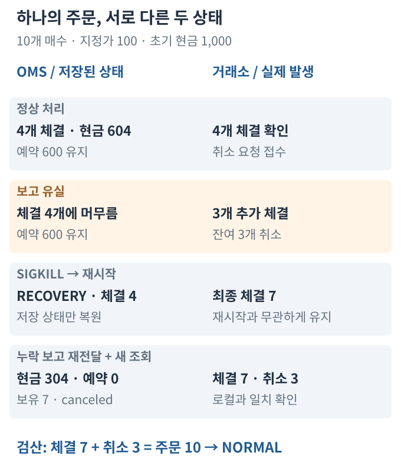
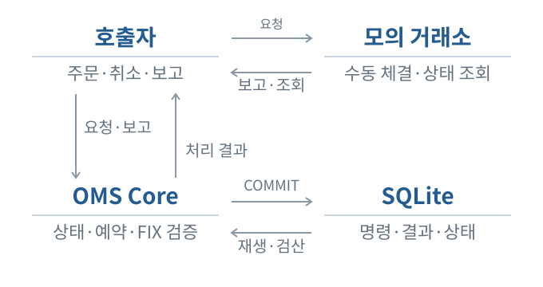

# Order Management System Simulator

취소 중 체결과 장애가 겹쳐도, **주문 상태·현금·보유 수량을 확인하며 복구하는 Order Management System 시뮬레이터**입니다.

Python 3.11+, SQLite, 제한된 FIX 4.4 업무 필드

**설계의 중심:** 주문 전달 전 예약 저장 → 중복 보고의 회계 반영 방지 → 대사 후 정상 복귀

[복구 데모](examples/fix_order_recovery.py) · [설계 근거](docs/ENGINEERING_AUDIT.md) · [운영 절차](docs/OMS_OPERATIONS.md)

## 한 주문을 끝까지 추적하기

주문을 승인하면 매수 대금을 예약합니다. 체결 보고는 현금과 보유 수량을 갱신하고, 취소 요청만으로는 예약을 해제하지 않습니다. 거래소의 최종 사실을 확인해야 남은 예약을 해제할 수 있습니다.

## 취소 요청은 체결을 멈추지 않습니다

10개 매수 주문에서 4개가 체결된 뒤 취소를 요청합니다. 거래소에서는 3개가 더 체결되고 잔여 3개가 취소되지만, 보고가 유실됩니다. **로컬 체결은 4개, 거래소 체결은 7개**인 상태에서 프로세스를 강제 종료합니다.



재시작은 저장된 상태를 복원할 뿐입니다. 누락 보고를 중복·역순으로 재전달하고 새 조회가 일치한 뒤에야 `NORMAL`로 복귀합니다. 최종 **현금 304, 예약 0, 보유 7, 체결 7, 취소 3**, 주문 상태는 `canceled`입니다.

수치는 [실행 데모](examples/fix_order_recovery.py)의 수동 체결·수수료 0 합성 예제이며, 독립 Decimal 계산으로 검산합니다. 응답이 없다는 이유만으로 예약을 풀거나 주문을 재전송하지 않습니다.

## 주문을 보내는 책임과 상태를 기록하는 책임



호출자가 모의 거래소와 통신하고 보고·조회 결과를 OMS에 전달합니다. OMS는 승인·예약을 SQLite에 커밋한 뒤 전달할 요청을 반환합니다. 직접 네트워크 주문을 전송하는 구조가 아닙니다.

- **주문과 자금:** 신규·부분 체결·완전 체결·취소·거부 상태를 관리하고, 매수 현금·매도 재고를 예약합니다.
- **취소와 체결의 경합:** 취소 요청과 완료를 구분해 추가 체결을 반영합니다. 보고 ID·체결 ID로 중복 회계 반영을 막고, 충돌 사실은 상태 변경 없이 거부합니다.
- **복구와 대사:** 명령·결과·스냅샷을 함께 저장하고 전체 이력을 재생합니다. 새 거래소 조회·누락 보고·미해결 사건을 확인한 뒤 정상 복귀를 허용합니다.

지원 진입점은 `TradingSession.create/open(journal_type=FixJournal)`입니다. 저수준 journal 직접 호출은 실행 소유권 보호를 우회합니다.

## 실패를 주입하고, 회계 불변식으로 확인합니다

**637개 테스트 통과, skip 0. 공개 실행 예제 19개 통과.**

24개 보고 순서 × 5개 재시작 경계, 커밋 전후 프로세스 종료, 실제 SIGKILL, 중복·역순 보고, 잘못된 필드·누락 체결을 검증합니다. 매 단계에서 현금·예약·수량을 검산하며, 미해결 상태의 정상 복귀와 협력 POSIX API의 두 번째 실행 프로세스를 차단합니다.

[GitHub Actions CI](https://github.com/Min9s/order-management-system-simulator/actions/workflows/ci.yml)에서 Python 3.11·3.13으로 전체 테스트와 공개 실행 예제를 검증합니다.
[회계 불변식·설계 감사](docs/ENGINEERING_AUDIT.md) · [전체 실행 근거](docs/OPERATIONAL_EVIDENCE.md)

## 5분 안에 복구 시나리오 실행하기

Python 3.11+, macOS/Linux. API Key·계좌·시장 데이터 없이 실행합니다.

```bash
git clone https://github.com/Min9s/order-management-system-simulator.git
cd order-management-system-simulator
python3 -m venv .venv
source .venv/bin/activate
python -m pip install '.[dev,historical]'
python examples/fix_order_recovery.py
python scripts/verify_project.py
```

데모는 직접 생성한 자식만 SIGKILL하고 임시 DB를 정리합니다. 테스트만 실행하려면 `python -m pytest -q`를 사용합니다. 그림 생성은 표준 라이브러리만 사용하는 `python assets/readme/build_visuals.py`로 실행합니다.

읽을 코드: [대표 데모](examples/fix_order_recovery.py), [주문 상태](src/market_microstructure/order_lifecycle.py), [자금·예약](src/market_microstructure/funded_orders.py), [SQLite 저장](src/market_microstructure/funded_journal.py), [FIX·복구 테스트](tests/test_fix_adapter.py)

## 범위와 한계

모의 거래소·로컬 SQLite·지원 API에서 검증한 시뮬레이터입니다. 실제 거래소·실계좌 전체 대사·상용 운영 성능은 검증하지 않았습니다. 단일 통화·수수료 0·차입 및 공매도 금지의 현금 계정입니다.

FIX 4.4는 신규 주문(35=D), 체결 보고(35=8), 취소 요청(35=F), 종료 주문의 제한된 취소 거부(35=9), 명시적 상태 조회를 위한 업무 필드 객체만 지원합니다. 주문·체결 정정, wire/session 엔진, Resend/Gap Fill, socket 재접속은 없습니다.

전체 이력 검산 비용은 이력과 함께 증가합니다. 코드 해시가 달라진 DB는 거부합니다. 자동 이관·재전송·타이머·외부 알림·전원 손실·분산 fencing·Windows/NFS·대규모 운영은 제공하지 않거나 미검증입니다.

[주문 상태](docs/ORDER_LIFECYCLE.md) · [자금 계약](docs/ORDER_FUNDING.md) · [저장·복구](docs/DURABLE_ORDERS.md) · [FIX 범위](docs/FIX_ADAPTER.md) · [운영 절차](docs/OMS_OPERATIONS.md)

기존 연구·파생계약 IOC 코드는 현금 OMS와 별도 경로로 보존합니다. [학습 안내](docs/LEARNING.md) · [출처·AI 보조 사용](PROVENANCE.md). 별도 LICENSE 파일은 없습니다.
