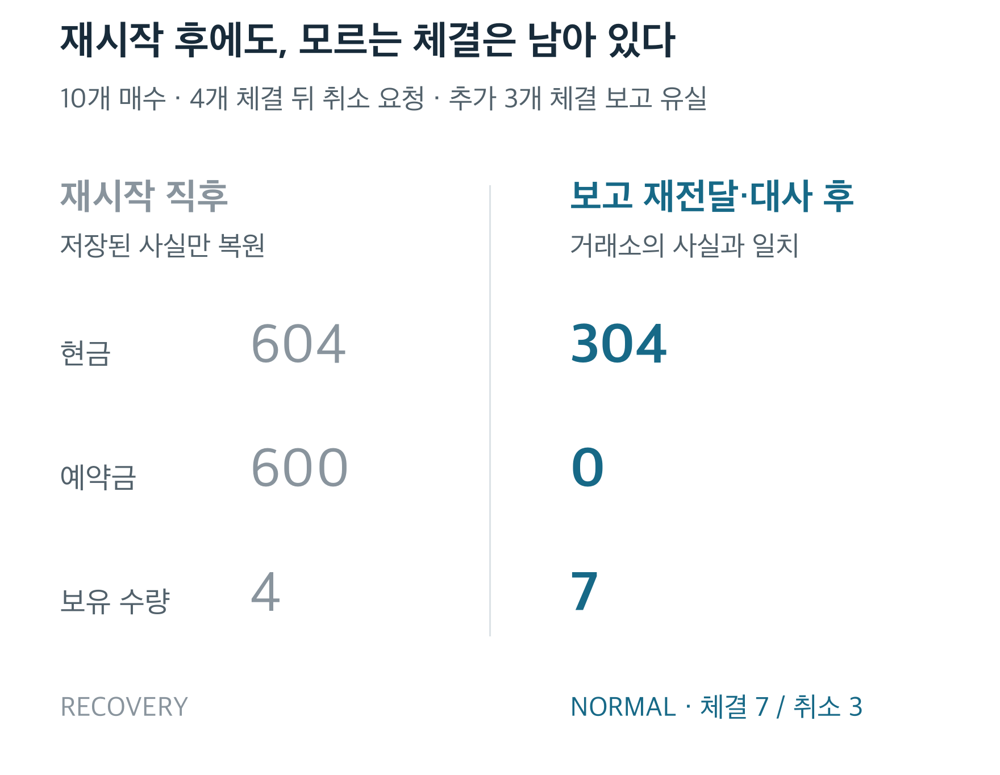

# OMS Simulator

주문을 접수하고, 돈을 예약하고, 체결 결과를 계정에 반영하는 **주문 관리 시스템 시뮬레이터**입니다.

**접수** — 주문을 검증하고 매수 현금·매도 재고를 예약합니다.<br>
**처리** — SQLite 커밋 후 요청을 반환합니다. 호출자가 모의 거래소로 전달합니다.<br>
**반영** — 보고를 검증해 주문 상태·현금·보유 수량을 함께 갱신합니다.

Python 3.11+ · Decimal · SQLite · 제한된 FIX 4.4 업무 필드

[실행 데모](examples/fix_order_recovery.py) · [코드 읽기](src/market_microstructure/trading_session.py) · [설계·검증 근거](docs/ENGINEERING_AUDIT.md)

---

## 응답을 잃은 주문을 어떻게 마무리하는가

10개 매수 주문에서 4개가 체결된 뒤 취소를 요청합니다. 거래소에서는 3개가 더 체결되고 잔여 3개가 취소되지만, 보고가 유실된 채 프로세스가 SIGKILL됩니다.



재시작은 저장된 사실만 복원합니다. **누락 보고의 수동 재전달과 새 조회**가 일치해야 정상 처리로 돌아갑니다. 최종 주문은 `canceled`이며 체결 7개와 취소 3개를 모두 보존합니다.

수치는 [공개 복구 데모](examples/fix_order_recovery.py)의 수동 체결·수수료 0 합성 계정입니다. 초기 현금 1,000에서 `4×99 + 3×100`을 차감한 304를 독립 Decimal 원장으로 검산합니다. 조회만으로 누락 Trade ID를 알아내거나 자동 재전송하지 않습니다.

## 구현을 확인할 네 가지 질문

| 질문 | 구현과 근거 |
|---|---|
| 같은 체결 보고가 두 번 오면? | 보고 ID·체결 ID를 검증해 중복 회계 반영을 막습니다. [FIX 테스트](tests/test_fix_adapter.py) |
| 취소 요청 뒤 체결되면? | 주문과 취소 상태를 분리하고 추가 체결을 반영합니다. [주문 상태 계약](docs/ORDER_LIFECYCLE.md) |
| 저장 도중 종료되면? | 명령·결과·스냅샷을 한 트랜잭션에 저장하고 재생·검산합니다. [저장 경계](docs/DURABLE_ORDERS.md) |
| 재시작하면 바로 주문할 수 있나? | `RECOVERY`로 시작해 조회·누락 보고·미해결 사건을 확인합니다. [운영 절차](docs/OMS_OPERATIONS.md) |

637개 테스트·19개 공개 예제에서 중복·역순 보고, 24개 보고 순서 × 5개 재시작 경계, 커밋 전후 종료와 실제 SIGKILL을 검증합니다. [전체 검증 기록](docs/OPERATIONAL_EVIDENCE.md) · [CI](https://github.com/Min9s/order-management-system-simulator/actions/workflows/ci.yml)

## 직접 한 주문을 복구해 보기

macOS/Linux · Python 3.11+ · API Key와 시장 데이터 없이 실행합니다.

```bash
git clone https://github.com/Min9s/order-management-system-simulator.git
cd order-management-system-simulator
python3 -m venv .venv
source .venv/bin/activate
python -m pip install '.[dev,historical]'
python examples/fix_order_recovery.py
python scripts/verify_project.py
```

데모는 자신이 만든 자식만 SIGKILL하고 임시 DB를 정리합니다. `python -m pytest -q`로 테스트만 실행할 수 있습니다.

## 더 깊이 읽기

[세션·실행 소유권](src/market_microstructure/trading_session.py) → [FIX 업무 필드](src/market_microstructure/fix_adapter.py) → [원자적 저널](src/market_microstructure/funded_journal.py) → [자금·예약 계약](docs/ORDER_FUNDING.md)

모의 거래소와 단일 통화·수수료 0·차입 및 공매도 금지 현금 계정으로 한정합니다. 실제 거래소 운영·성능·전원 손실·분산 fencing·Windows/NFS는 검증하지 않았습니다. 전체 이력 검산 비용은 이력과 함께 증가하고 코드 해시가 달라진 DB는 거부합니다. 저수준 journal 호출은 실행 소유권 보호를 우회합니다.

FIX 4.4는 신규 주문·체결 보고·취소 요청·제한된 취소 거부·명시적 조회의 업무 필드 객체입니다. wire/session·Resend/Gap Fill·socket 재접속·정정·자동 재전송·타이머·DB 이관은 없습니다. [지원 범위](docs/FIX_ADAPTER.md)

[학습 안내·기존 연구](docs/LEARNING.md) · [출처·AI 보조 사용](PROVENANCE.md). 별도 LICENSE 파일은 없습니다. 그림 재생성: `python assets/readme/editorial.py` (Matplotlib·한국어 글꼴 필요).
