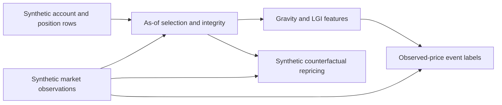

# Liquidation-Aware Market Microstructure Research

A small, offline Python project for **Quant Research Engineering**: observable
liquidation exposure, point-in-time data selection, sampled-price event studies,
and a synthetic counterfactual repricing demonstration.

**LGI describes a selected observed position sample. It does not measure total-market
liquidation pressure, actual liquidation probability, or expected trading profit.**

The Python package remains `market_microstructure`; the distribution remains
`market-microstructure-toolkit`. Start with [Getting Started](#getting-started) and
[LEARNING.md](LEARNING.md) for a guided code reading path.

## Project Overview

- Standard-library calculation core; pytest for tests.
- Optional PyArrow for local Parquet integration. No exchange client or credentials.
- Public examples and fixtures are **SYNTHETIC_TEST_ONLY**: invented identifiers,
  positions, timestamps, prices, and outcomes.
- Real inputs, account identities, private experiment scripts, manifests, and results
  are not distributed. Running the public demo does not reproduce private findings.
- No ML, OMS, order execution, trading strategy, or profitability backtest.

The portfolio demonstrates explicit data contracts, rejection reasons, timestamp
boundaries, numerical checks, and reproducible research inputs. It is deliberately
bounded rather than a general trading platform.

## Research Motivation

A liquidation threshold is conditional exposure, not an order or a probability.
The research question is whether a proximity-weighted position statistic captures
information beyond the current price moving through an observed threshold distribution.

This distinction matters: LGI can change without a new position. Prices, newly
observed accounts, refreshed thresholds, missing values, and stale records can all
change the calculation. The counterfactual demo separates repricing from a changed
observed state without claiming causal identification.

Private historical replay, exploratory event study, and counterfactual audit informed
these questions. Their inputs and results remain private. The public evidence here
is executable synthetic arithmetic and tests, not an independently reproducible
empirical alpha claim.

## System Architecture



Future prices are used only for outcome labels, never to update earlier features or
choose earlier accounts. Counterfactual repricing compares current and preceding
states; it does not consume event-study labels.

```text
src/market_microstructure/
  orderbook.py          # spread, best-level OBI and notional depth
  order_flow.py         # buy/sell notional trade imbalance
  gravity.py            # exposure preparation, exponential decay, LGI
  asof.py               # latest received record and explicit unavailability
  historical.py         # BTC replay and header/child integrity checks
  historical_io.py      # optional local Parquet and hash-pinned private outputs
  event_study.py        # sampled-price outcomes and descriptive cohorts
  event_study_io.py     # protocol hashes and static private HTML/SVG reports
examples/
  research_walkthrough.py  # public synthetic pipeline and repricing example
  synthetic_walkthrough.py
  liquidation_core.py
  historical_synthetic.py
  event_study_synthetic.py
tests/                 # synthetic unit and Parquet integration tests
```

Calculation modules do not import the original Liquidation Gravity project.
The native replay adapter is intentionally BTC-specific. All-asset child rows are
needed to validate account completeness; only BTC positions contribute to exposure.

## Microstructure Features

Prices must be finite and positive; quantities must be finite and nonnegative.
Units must be consistent and contract multipliers applied before calling the functions.

| Function | Calculation / output | Important boundary |
|---|---|---|
| `bid_ask_spread(b, a)` | `mid`, `absolute=a-b`, `bps=(a-b)/mid*10000` | Requires `0 < b <= a`; locked books allowed |
| `order_book_imbalance(qb, qa)` | `(qb-qa)/(qb+qa)` | Both zero returns `None` |
| `notional_depth(b, a, qb, qa)` | `bid_notional`, `ask_notional`, `total_notional` | Best level only; both zero returns zero depth |
| `trade_imbalance(rows, decision_ns=..., window_ns=...)` | `buy_notional`, `sell_notional`, `imbalance`, `trade_count` | Zero total notional returns `None` |

For `b=99, a=101, qb=3, qa=1`, spread is 2 or 200bps, OBI is 0.5,
and depths are 297 / 101 / 398. The two-sided depth sum is not an executable
amount in one direction.

Trades require `timestamp`, `ingested_at`, `price`, `size`, and exactly `buy` or `sell`.
The window is `(decision-window, decision]` by event time, with receipt at/before
decision. The caller supplies one asset, a consistent side convention, and deduplicated
rows. All supplied rows are validated, including rows outside the window.
The small trade helper applies both time filters but does not reject clock inversion;
as-of selection and historical replay apply stricter clock checks.

Invalid numeric inputs, bools, crossed books, and nonfinite calculations raise
`ValueError`. Quote functions do not check freshness because they have no timestamp input.

## Liquidation Gravity / LGI

For signed size `q`, observed liquidation threshold `L`, and reference mid `P`:

```text
notional = abs(q) * P
distance_bps = abs(L-P) / P * 10000
G_up   = sum(short notional * exp(-distance_bps / tau_bps))
G_down = sum(long  notional * exp(-distance_bps / tau_bps))
LGI    = (G_up-G_down) / (G_up+G_down+epsilon)
```

`prepare_exposure(size, threshold, reference)` returns inclusion status, reason,
side, notional, and distance. Missing thresholds are excluded with a reason; they
are never inferred or replaced with zero. Thresholds equal to the reference or on
the wrong side for the position are excluded, not interpreted as observed liquidations.

`gravity(exposures, tau_bps)` takes `(notional, distance_bps)` pairs;
`liquidation_imbalance(up, down, epsilon=1e-12)` returns the normalized ratio.
Observed empty exposure gives zero; missing or wholly unusable observations are a
separate availability condition in replay.

The decay is a chosen distance weighting, not a calibrated probability function.
A near-extreme LGI is relative imbalance, not necessarily large absolute exposure.
A common price multiplier largely cancels in LGI apart from epsilon, while changes
in distance and inclusion boundaries remain price-dependent.
Historical replay prepares boundaries with Decimal, then uses float decay and summation.
The smaller public single-position helper uses float and can differ at rounding boundaries.

## As-of Data Integrity

`select_asof(rows, decision_ns=..., max_age_ns=..., source_kind=..., source=..., entity=...)`
returns `status`, `reason`, `record`, `record_id`, and `age_ns`.

- **Event/state time:** `timestamp`; **receive time:** `ingested_at`;
  **decision time:** `decision_ns`. All are nonnegative integer nanoseconds.
- Select the latest receipt at/before decision **before** testing event time,
  clock inversion, completeness, and age. Do not revive an older valid state.
- A received-basis timestamp must equal receipt time. It is not an independently
  measured exchange clock.
- Conflicting latest receipts, stale states, and incomplete states remain unavailable.
- `complete` and provenance labels are caller assertions, not clock or data certificates.

`replay_history(data, policy)` additionally checks snapshot IDs, account identity,
all-asset child counts, child timestamps, duplicate assets, market session, and freshness.
Accounts enter only after receipt. Output retains all decisions and exclusion reasons;
repeated evaluations are distinguished from unique observations. It does not certify
full-market coverage, failed-request completeness, or historical signal publication time.

## First Passage Event Study

`study_events(features, contexts, books, policy, rules)` connects fixed features to
observed future mid prices. `observed_outcome(...)` returns an upper-first `+1`,
lower-first `-1`, neither `0`, or a null label plus a censoring/ambiguity reason.

```text
upper/lower = reference * (1 +/- barrier_bps/10000)
future window: decision < received <= decision+horizon
future mid change (bps) = (terminal_mid/reference-1)*10000
```

The synthetic examples use 60s/300s horizons, inclusive +/-10bps barriers, and a 5s
maximum observation gap/age. Rules are fixed before outcomes, not selected for good results.

- Full horizon coverage is required even after an early hit.
- Observation end, gaps, stale prices, clock errors, and session changes censor results.
- Equal first upper/lower receipt times are ambiguous. Conflicting terminal prices censor.
- Terminal price is the last fresh future observation at/before the end; no interpolation
  or later price is used.
- LGI/OBI bins are fixed: `[-1,-0.5)`, `[-0.5,0)`, `[0,0.5)`, `[0.5,1]`.
- OBI comparison requires Phase 2 BBO event/receipt alignment and the same valid cohort.
- Overlapping windows are not IID. Start-aligned non-overlapping forward windows are
  descriptive sensitivity subsets, not proof of independence.

These are **sampled observed crossings**, not continuous first passage, actual
liquidation events, fills, or a prediction model. Neither is not a zero price change.

## Price-Only / State-Only Counterfactual Analysis

The public implementation is a small **synthetic example**, not a general historical
counterfactual engine. The private historical audit scripts and results are not included.
For baseline time `b` and current time `t`:

```text
B  = F(P_b, S_b)    # baseline
A  = F(P_t, S_t)    # actual synthetic state
PO = F(P_t, S_b)    # freeze baseline payload, change price
SO = F(P_b, S_t)    # freeze baseline price, change observed state
price_effect = PO-B
state_effect = SO-B
interaction = A-PO-SO+B
A-B = price_effect + state_effect + interaction
```

The demo selects +30s -> +60s in advance, changes one invented account at +60s,
and checks against historical replay. Frozen payload repricing is a counterfactual,
not a claim that an old snapshot is currently fresh. Existing price-side exclusion
rules are retained; crossing a threshold does not simulate liquidation.

The state includes observations and their eligibility, not just true positions.
Account composition, missing thresholds, and stale transitions must not be called
trades. IDs/timestamps alone are not a material payload change, but a freshness-status
transition is an eligibility change. State-equality cohort counts from private research
are not reproduced by this two-account demo.

The interaction makes independently measured price/state effects non-additive.
Sequential attributions depend on order and reference. The identity above is arithmetic,
not causal identification. Repricing error, persistence comparison, and change direction
are diagnostic ideas; no public empirical alpha or causal contribution is claimed.

## Tests & Reproducibility

```bash
python -m pytest
python -m pip check
```

For all Parquet integration tests, install both extras in Getting Started.
Without PyArrow, relevant integration tests skip; report this rather than calling it
a full-suite pass. Test fixtures, including tests of `REAL_OBSERVED` provenance rejection,
are synthetic. See [PUBLICATION_AUDIT.md](PUBLICATION_AUDIT.md) for the verified run record.

Tests cover hand calculations, numerical and time boundaries, missing thresholds,
stale/incomplete snapshots, latest-first selection, future-data exclusion, censoring,
OBI alignment, hash changes, output guards, and synthetic counterfactual identities.
Only versions actually executed are validated; `requires-python >=3.11` is a declared
compatibility range rather than evidence of testing every Python version.

Optional native I/O (`historical_io` and `event_study_io`) pins local input paths,
file sizes, SHA-256, policy, and code hashes; verifies bytes before/after reading; and
replays fixed features before outcomes. New output paths must be outside every Git
repository and outside the raw input root. Existing output is never overwritten.
The report includes code snapshots and explicit exclusions. Inspect CLI arguments with:

```bash
python -m market_microstructure.historical_io --help
python -m market_microstructure.event_study_io --help
```

The local-data adapter expects a specific native schema, not arbitrary exchange files.
No native policy, input manifest, actual dataset, or actual report is shipped.
Output guards and `.gitignore` reduce accidental inclusion; they are not general
anonymization or secret-detection guarantees.

## Limitations

- Selected observed accounts are not all market participants; unavailable and missing
  thresholds can bias exposure. Valid observed notional coverage is not market coverage.
- Mid-based proximity does not implement an exchange's liquidation or margin engine.
- Snapshot refresh can update a threshold without a new trade. Source timestamps do
  not certify exchange clocks, collection completeness, or calculation latency.
- Point-in-time selection does not prevent every form of researcher selection bias.
- BBO contains no queue position or reliable passive-fill model.
- Float rounding, underflow and overflow limits remain; this is not accounting software.
- A single session, serial dependence, sparse bins and changing cohorts limit inference.
- Reproduction and unit tests validate computation, not causal effects, generalization,
  prediction superiority, or profitability.

## Getting Started

Run from a checkout of this repository on macOS/Linux:

```bash
python3 -m venv .venv
source .venv/bin/activate
python -m pip install -e '.[dev,historical]'
python examples/research_walkthrough.py
python -m pytest
python -m pip check
```

The main demo writes no files, requires no native dataset, credentials, or API calls,
and prints `SYNTHETIC_TEST_ONLY`. It connects the four microstructure features,
as-of selection, Gravity/LGI, event labels and a counterfactual identity.

Smaller reading examples remain available:

```bash
python examples/synthetic_walkthrough.py
python examples/liquidation_core.py
python examples/historical_synthetic.py
python examples/event_study_synthetic.py
```

For a synthetic static HTML/SVG report, choose a **new** path outside Git repositories:

```bash
python examples/event_study_synthetic.py --output /tmp/NEW_SYNTHETIC_REPORT.html
```

Core/demo-only installation: `python -m pip install -e .`.
For core tests add `.[dev]`; for the complete suite use `.[dev,historical]` as above.
Package installation may download build/test dependencies; calculations and examples
make no network requests at runtime.

## Provenance, AI Assistance & License Status

The original Liquidation Gravity research supplied the microstructure definitions,
exponential Gravity/LGI, threshold-side rules, latest-receipt selection principles,
and sampled-price censoring conventions. This repository reimplements/adapts those
bounded ideas without importing its collectors, storage platform, Surface system,
models or dashboards. See [PROVENANCE.md](PROVENANCE.md) for the file-level mapping.

AI assisted design, implementation, tests, documentation, and review. Executable
checks and the maintainer's ability to explain the code are the portfolio evidence;
the project does not claim entirely unaided implementation or novel mathematical formulas.

The maintainer confirmed authority to license the personal work. **No LICENSE has
been selected or added yet.** MIT is the recommended simple permissive option;
Apache-2.0 is an alternative with an explicit patent grant. Do not describe this as
MIT/Apache-licensed until the owner chooses and the license text is added.

A LICENSE is **not required to make a GitHub repository public**. Public visibility
does not itself grant an open-source license: GitHub users may view/fork under its
terms, while broader reuse permissions remain ungranted by this project. Choosing
MIT would grant its stated use/modification/distribution permissions subject to its
notice conditions. See [GitHub's official policy](https://docs.github.com/en/repositories/managing-your-repositorys-settings-and-features/customizing-your-repository/licensing-a-repository).
Public-source readiness and open-source licensing readiness are separate decisions.
