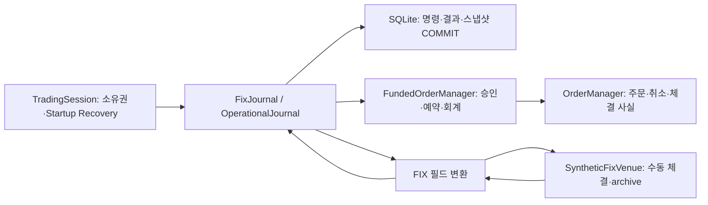

# Synthetic OMS — Recovery, Reconciliation & FIX Business Fields

주문 응답 유실·취소와 체결 경합·프로세스 종료가 발생해도 **주문 사실과 현금·예약·보유 수량이 일치하는지 검증하는 Python OMS 시뮬레이터**입니다.
SQLite 저널, Startup Recovery, Incident와 위험 통제, 제한된 FIX 4.4 필드 어댑터를 구현했습니다.
부모의 모의 거래소를 유지한 채 클라이언트를 SIGKILL하고 독립 원장으로 복구 결과를 검산합니다.
실제 거래소 연결이나 상용 OMS 운영 성능을 주장하지 않습니다.

## Quick Start

Python 3.11+, macOS/Linux의 **현재 변경이 포함된 checkout**에서 실행합니다.
이 문서의 기능은 [개발 브랜치 feat/oms-operational-evidence](https://github.com/Min9s/liquidation-aware-market-microstructure-research/tree/feat/oms-operational-evidence)에 있습니다.
기존 main/v0.2.0의 기능 및 검증 기록과 구분합니다.

```bash
git clone --branch feat/oms-operational-evidence https://github.com/Min9s/liquidation-aware-market-microstructure-research.git
cd liquidation-aware-market-microstructure-research
python3 -m venv .venv
source .venv/bin/activate
python -m pip install '.[dev,historical]'
python examples/fix_order_recovery.py
python scripts/verify_project.py
```

대표 데모는 생성한 자식만 SIGKILL하고 임시 DB를 정리합니다. API 키·계좌·외부 주문 전송은 없습니다.
입력은 `SYNTHETIC_TEST_ONLY`, 가격/체결은 수동 지정, 수수료는 0입니다. 난수 없이 결정론적으로 실행합니다.
UUID/PID는 실행별 진단 값이며 회계 결과에는 영향을 주지 않습니다.

## Core Features

- 공유 현금/보유 수량 예약과 신규 위험 승인, 시세 TTL·노출 한도 검사
- 취소 요청과 종료 상태 분리, 부분 체결·취소 경합, 중복/역순 보고 검증
- 명령·결과·스냅샷 원자적 저장, 전체 재생 검산과 재시작 후 대사
- 영속 Incident, NORMAL/RESTRICTED/RECOVERY, 주문별 구조화된 진단
- 협력 POSIX 프로세스용 단일 소유 실행 API와 매 시작의 새로운 조회 검증
- FIX 태그/값 객체의 원주문·체결·취소 변환과 누락 Trade 영속 보류

## System Architecture



지원 실행 진입점은 `TradingSession.create/open(journal_type=FixJournal)`입니다.
저널 클래스는 저수준 저장소 API이며 직접 쓰면 실행 소유권 보호를 우회합니다.
`_record`, `_verify`, reducer와 내부 dict는 안정적인 외부 확장 인터페이스가 아닙니다.
연구 LGI·v1 파생계약 IOC·v2 현금 OMS는 독립 경로이며 회계를 합치거나 전략 신호로 연결하지 않았습니다.

## Order Lifecycle

`pending_new/unknown → open → partially_filled → filled 또는 canceled`이며 신규 거부는 `rejected`입니다.
취소 요청은 별도의 `cancel_status=pending`으로 남아 추가 체결을 허용합니다.
보고 ID·Execution ID·revision을 구별하고 상충하는 체결 사실은 무변경 거부합니다.
시세 장애가 기존 체결 반영과 주문 정리를 막지 않습니다.
[상태 계약](docs/ORDER_LIFECYCLE.md) · [회계 계약](docs/ORDER_FUNDING.md)

## Durability & Recovery

승인·예약을 커밋한 뒤 outgoing을 반환합니다. 재호출은 원래 주문을 재발송하지 않습니다.
SQLite는 FULL synchronous이며 매 명령 전체 이력과 저장 스냅샷을 비교합니다.
미응답/조회 부재만으로 주문을 실패 확정하거나 예약을 풀지 않습니다.
정상 close도 미수신 거래소 사실이 없음을 증명하지 못하므로 TradingSession은 항상 RECOVERY에서 시작합니다.
[저장 계약](docs/DURABLE_ORDERS.md) · [Startup 설계](docs/FIX_ADAPTER.md)

## FIX 4.4 Business-Field Adapter

35=D/8/F, 종료 주문의 제한된 35=9, 명시적 상태 조회를 지원하며 35=G는 제외합니다.
ExecType은 이벤트 종류, OrdStatus는 현재 상태로 구분합니다.
CumQty/LeavesQty/AvgPx와 실제 Trade ExecID를 검산하며 누락 체결을 평균 가격으로 만들어내지 않습니다.
**바이트 wire protocol과 FIX 세션 엔진은 없습니다.** 재전달은 Python fixture archive이며 FIX Resend가 아닙니다.
[지원 필드·프로파일·한계](docs/FIX_ADAPTER.md)

## Reconciliation & Risk Controls

기한을 넘긴 조회 부재/상태 차이와 사실 충돌은 영속 Incident로 추적합니다.
RESTRICTED/RECOVERY에서 신규 매수를 막고 기존 보고·가능한 취소·조회·보유 재고 내 매도는 허용합니다.
NORMAL 복귀에는 미해결 사건이 없고 누락 Trade가 해결됐으며 모든 등록 주문의 새 일치 조회가 필요합니다.
JSON 진단은 주문·명령·보고·Incident ID를 연결합니다. 타이머와 외부 알림 전송은 호출자/미구현 범위입니다.
[운영 절차](docs/OMS_OPERATIONS.md)

## Testing & Operational Evidence

현재 로컬 검증 결과는 **637 tests, skip 0 · 공개 예제 19개**입니다. 최신 변경의 원격 CI는 실행하지 않았습니다.
기존 v0.2.0의 589개/15개 결과 및 과거 성능 기록과 구분합니다.

대표 데모: 주문10@100 → 4@99 체결 → 취소 중 3@100 추가 체결 → 잔여3 취소 응답 유실 →
SIGKILL → Startup RECOVERY → 누락 사실 Incident → 역순/중복 재전달 → 새 조회 → NORMAL.
최종 **현금304·보유7·체결7·취소3·예약0**을 독립 Decimal 계산으로 비교하며 불일치하면 실패합니다.

검증은 24개 보고 순서/5개 재시작 경계, 커밋 전후 실제 프로세스 종료, 두 번째 실행 프로세스 배제,
시세 경계, 잘못된 필드/ID, 누락 이력, 고정 시드의 매 단계 회계 검산을 포함합니다.
[최종 감사·심각도·불변식](docs/ENGINEERING_AUDIT.md) · [전체 실행 기록](docs/OPERATIONAL_EVIDENCE.md)

## Benchmark Results

현재 전체 구현을 조건별 새 DB 20개로 측정했습니다. 아래는 로컬 p50(ms)입니다.

| 선행 이력 / 활성 / 주문당 체결 / 중복명령 | 신규 저장 | 보고 반영 | Startup |
|---|---:|---:|---:|
| 10 / 1 / 1 / 0 | 1.592 | 1.766 | 7.104 |
| 50 / 1 / 1 / 0 | 9.159 | 9.258 | 30.642 |
| 150 / 1 / 1 / 0 | 49.512 | 49.303 | 152.671 |
| 50 / 5 / 1 / 0 | 17.051 | 16.840 | 54.800 |
| 50 / 1 / 3 / 0 | 15.059 | 14.806 | 48.558 |
| 50 / 1 / 1 / 20 | 17.850 | 17.712 | 58.601 |

전체 검산이 주요 비용이며 후보 로그 복사/FIX prefix 재검산 때문에 단순 선형 비용으로 단정하지 않습니다.
메모리 상태 전이·FIX 변환·대사·Incident·전체 검산도 별도 측정했습니다.
표본 분산·p95·구간·환경·원시값은 [감사 문서](docs/ENGINEERING_AUDIT.md)에 있습니다.
p99는 표본 부족으로 생략했습니다. 과거 약9ms를 현재 성능으로 재사용하지 않았습니다.
실거래 latency/throughput이나 HFT 성능이 아니며 CI 시간 합격선은 없습니다.

```bash
python scripts/benchmark_audit.py --output /tmp/oms-audit.json
```

## Known Limitations

- 실제 거래소 연동/실제 계좌 전체 대사 검증이 아닙니다. Synthetic Venue에 한정됩니다.
- FIX wire·Logon·Heartbeat·sequence·Resend/Gap Fill·실제 socket 재접속은 없습니다.
- 현금 OMS는 단일 통화·수수료0·무차입/공매도 금지이며 체결 정정은 없습니다.
- POSIX 락은 협력 API·로컬 파일 경로 범위입니다. 직접 DB 쓰기·파일 교체·분산 fencing·Windows/NFS를 보장하지 않습니다.
- 코드 해시가 바뀐 DB는 거부하며 자동 이관·로그 회전·전원 손실·대규모 운영은 미검증입니다.
- 전체 재생과 누적 증거 저장 비용이 증가합니다. 실제 거래 환경 latency/throughput은 측정하지 않았습니다.
- 타입 힌트/정적 검사와 내부 API 결합에 개선 여지가 있습니다. Critical 오류 부재를 증명한 것은 아닙니다.

## Further Reading

[이력서·영어 소개·면접 답변](docs/PORTFOLIO_INTERVIEW.md) · [학습 안내](docs/LEARNING.md) ·
[연구 계약](docs/RESEARCH.md) · [기존 IOC 사례](docs/CASE_STUDY.md) · [출처](PROVENANCE.md)

계산 코어는 표준 라이브러리만 사용합니다. 전체 회귀에는 pytest와 Parquet용 PyArrow를 설치합니다.
비공개 Liquidation Gravity 원본 데이터·결과는 배포하지 않습니다. AI 보조 사용은 PROVENANCE에 명시했으며 LICENSE 파일은 없습니다.
