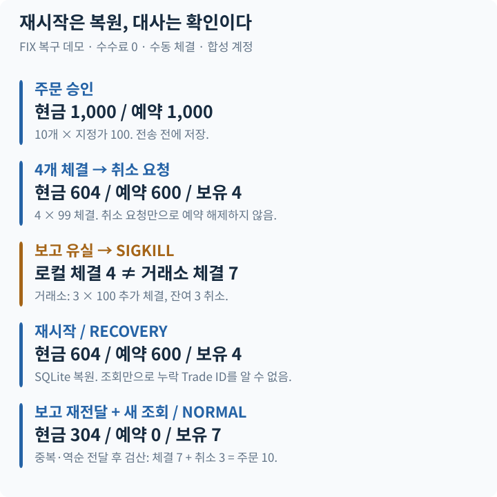
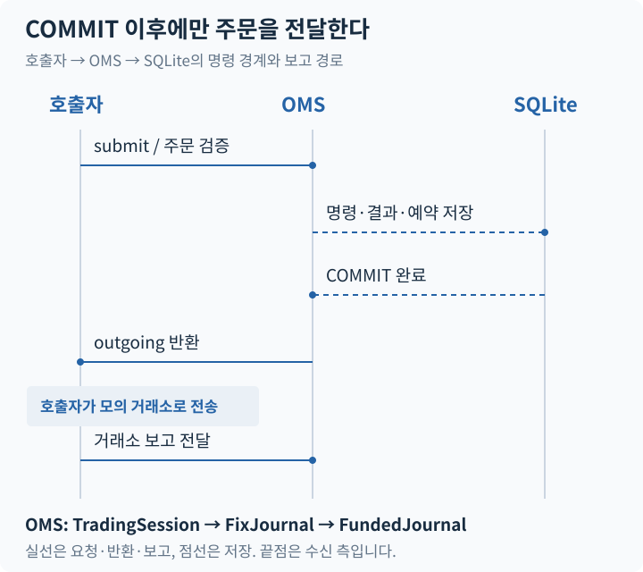
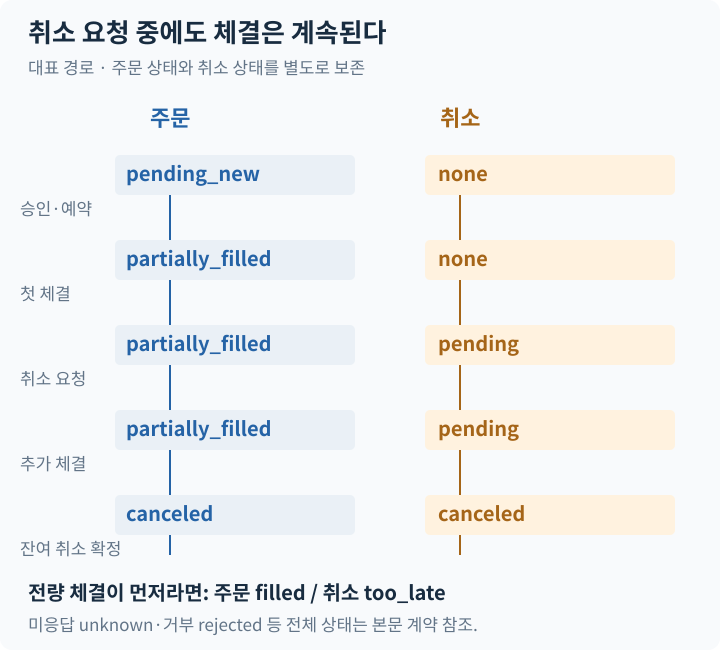

# Order Management System Simulator

**주문은 보냈는데 응답이 없다면, 예약한 돈을 언제 돌려줘야 할까?**

주문 상태·현금·보유 수량을 함께 관리하고, 취소와 체결이 경합하거나 프로세스가 종료된 뒤에도 거래소의 사실과 대조하는 Python OMS 시뮬레이터입니다. 네트워크 전송 성공을 가정하지 않고 **확인되지 않은 상태를 유지하는 방식**을 구현했습니다.

Python 3.11+ · Decimal · SQLite · FIX 4.4 업무 필드

[복구 데모](examples/fix_order_recovery.py) · [설계 감사](docs/ENGINEERING_AUDIT.md) · [검증 기록](docs/OPERATIONAL_EVIDENCE.md)

## 장애가 드러내는 설계



**재시작 직후에는 현금 604·예약 600이 그대로입니다.** 누락된 체결 보고를 재전달하고 새 조회가 일치한 뒤에야 현금 304·예약 0·보유 7을 확정합니다. 재시작만으로 거래소의 누락 체결을 알아내지는 못합니다.

이 그림은 [FIX 복구 데모](examples/fix_order_recovery.py)의 실제 SIGKILL 시나리오입니다. 수동 체결·수수료 0인 합성 예제이며, 독립 Decimal 원장으로 최종 계정을 검산합니다. 최종 주문은 `canceled`입니다. 잔여 3개가 취소되었어도 앞서 체결된 7개는 보유로 남습니다.

## 세 가지 설계 결정

### 1. 예약과 기록이 먼저, 발송은 그다음



OMS는 주문을 직접 전송하지 않습니다. 승인·예약을 커밋한 뒤 `outgoing`을 반환하고 호출자가 모의 거래소에 전달합니다. 같은 명령의 재호출은 기존 결과와 `outgoing=None`을 반환하므로, 과거 결과를 새 주문처럼 다시 보내지 않습니다.

[트랜잭션 경계](docs/DURABLE_ORDERS.md) · [실행 세션](src/market_microstructure/trading_session.py) · [자금 저널](src/market_microstructure/funded_journal.py)

### 2. 취소 요청은 주문 종료가 아니다



주문 상태와 취소 요청 상태를 따로 기록합니다. 취소 대기 중 추가 체결은 정상적인 입력입니다. 보고 ID·체결 ID가 이미 처리되었다면 회계를 반복하지 않고, 같은 ID에 다른 사실이 담겼다면 거부합니다.

매수는 현금, 매도는 재고를 예약합니다. 체결 시 대금과 수량을 반영하고, 미응답·미해결 취소가 남아 있으면 예약을 임의로 해제하지 않습니다. [주문 상태 계약](docs/ORDER_LIFECYCLE.md) · [예약과 회계](docs/ORDER_FUNDING.md)

### 3. 복구 완료는 저장 파일을 열었다는 뜻이 아니다

`TradingSession.open()`은 `RECOVERY`로 시작합니다. 기록 재생과 검산은 **로컬에서 알고 있던 사실**을 복원합니다. 이후 거래소 조회, 누락 보고, 미해결 사건을 확인해야 `NORMAL` 복귀를 허용합니다. 정상 종료 뒤 다시 열어도 이 절차를 건너뛰지 않습니다.

FIX 경로의 상태 조회만으로 누락 Trade의 ExecID를 복원할 수는 없습니다. 데모는 보관된 보고를 수동 재전달합니다. 이는 FIX session의 Resend 구현이 아닙니다. [FIX 계약](docs/FIX_ADAPTER.md) · [복구 운영 절차](docs/OMS_OPERATIONS.md)

## 어떤 실패를 검증했는가

| 주입한 상황 | 확인하는 성질 |
|---|---|
| 중복·역순 보고, 24개 보고 순서 × 5개 재시작 경계 | 체결·현금·보유가 중복 반영되거나 과거 상태로 돌아가지 않음 |
| 취소와 추가 체결의 경합 | 취소 요청만으로 체결이나 예약을 지우지 않음 |
| 커밋 전후 종료, 실제 SIGKILL | 저장된 명령·결과·계정 상태를 재생하고 검산 |
| 누락 체결·상충하는 필드·미해결 사건 | 잘못된 상태 반영과 성급한 정상 복귀를 차단 |
| 협력 POSIX API의 두 번째 실행 프로세스 | 지원 세션 API에서 실행 소유권을 보호 |

로컬 전체 검증: **637 tests passed, 0 skipped · 공개 예제 19개 통과.** [CI 실행 내역](https://github.com/Min9s/order-management-system-simulator/actions/workflows/ci.yml)은 별도로 확인할 수 있습니다. 테스트 수가 실제 거래소 운영 신뢰성을 의미하지는 않습니다.

## 직접 확인하기

macOS/Linux, Python 3.11+. API Key·계좌·시장 데이터 없이 실행합니다.

```bash
git clone https://github.com/Min9s/order-management-system-simulator.git
cd order-management-system-simulator
python3 -m venv .venv
source .venv/bin/activate
python -m pip install '.[dev,historical]'
python examples/fix_order_recovery.py
python scripts/verify_project.py
```

데모는 자신이 만든 자식 프로세스만 SIGKILL하고 임시 DB를 정리합니다. 테스트만 실행하려면 `python -m pytest -q`, README 그림 재생성은 `python assets/readme/build_portfolio.py`입니다.

코드는 **[복구 데모](examples/fix_order_recovery.py) → [FIX 어댑터](src/market_microstructure/fix_adapter.py) → [자금 저널](src/market_microstructure/funded_journal.py) → [주문 상태](src/market_microstructure/order_lifecycle.py) → [검증 테스트](tests/test_fix_adapter.py)** 순서로 읽을 수 있습니다.

## 구현의 경계

단일 통화·수수료 0·차입 및 공매도 금지 현금 계정의 모의 시스템입니다. 실제 거래소·실계좌 전체 대사·대규모 운영 성능은 검증하지 않았습니다.

FIX 4.4는 신규 주문, 체결 보고, 취소 요청, 제한된 종료 주문 취소 거부와 명시적 조회의 **업무 필드 객체**를 지원합니다. wire/session 엔진·socket 재접속·Resend/Gap Fill·주문 및 체결 정정은 없습니다. 자동 재전송·타이머·DB 이관도 제공하지 않습니다.

전체 이력 검산 비용은 이력과 함께 증가하며 코드 해시가 달라진 DB는 거부합니다. 저수준 journal 직접 호출은 실행 소유권 보호를 우회합니다. 전원 손실·분산 fencing·Windows/NFS는 검증 범위 밖입니다.

기존 연구·파생계약 IOC 코드는 별도 경로로 보존했습니다. [학습 안내](docs/LEARNING.md) · [출처·AI 보조 사용](PROVENANCE.md). 별도 LICENSE 파일은 없습니다.
