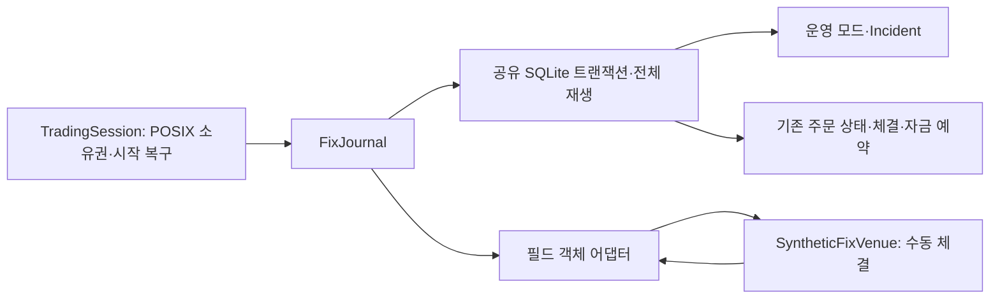

# FIX 4.4 필드 어댑터와 Startup Recovery

이 구현은 **FIX 태그/값을 문자열 dict로 표현하는 비즈니스 필드 어댑터**다.
SOH 바이트 파싱/직렬화, BeginString/BodyLength/CheckSum, 표준 헤더가 없는 내부 객체다.
완전한 FIX 메시지나 FIX 엔진, 실제 거래소 연결이라고 표현하지 않는다.

검토 자료는 [FIX 4.4 공식 배포](https://www.fixtrading.org/standards/fix-protocol/),
[QuickFIX FIX44 데이터 사전](https://github.com/quickfix/quickfix/blob/master/spec/FIX44.xml)이다.
ExecType은 보고가 발생한 이유이고 OrdStatus는 현재 주문 상태다. 취소 대기 중에도 체결은 가능하다.
QuickFIX는 [C++와 Python 바인딩](https://quickfixengine.org/c/documentation/getting-started/setting-up-your-project.html)을
제공한다. 이번 범위는 세션 없는 필드 변환이므로 새 네이티브 빌드 의존성을 도입하지 않았다.
QuickFIX 설치/빌드를 시도해 실패했다고 주장하지 않는다. 실연결에는 검증된 세션 엔진 도입이 필요하다.



## Startup 안전성

실행 프로세스는 `TradingSession.create/open(..., journal_type=FixJournal)`를 사용한다.
기존 운영 전용 경로에도 `journal_type=OperationalJournal`로 같은 보호를 적용할 수 있다.
저수준 FundedJournal/OperationalJournal/FixJournal은 저장소·관리 도구이며 직접 쓰면
소유권 보호를 우회한다. **보장은 TradingSession을 사용하는 협력 실행 프로세스 범위다.**
실제 권한으로 원시 SQLite 쓰기를 차단하거나 악성/다른 API 사용 프로세스를 fencing하지 않는다.

시작 순서는 canonical DB 경로 확인 → `.owner.lock`에 nonblocking POSIX flock 획득 →
기존 DB 전체 검산 → `session_start`와 RECOVERY/새 조회 epoch를 단일 커밋 → 핸들 반환이다.
두 번째 실행 프로세스는 저널을 열거나 모드를 바꾸기 전에 락 획득에 실패한다.
SQLite writer 직렬화와 프로세스 소유권은 서로 다른 보장이다.
macOS에서 DB 파일 자체의 flock과 SQLite가 충돌하는 것을 재현했으므로 별도 락 파일을 사용한다.
락 파일은 삭제하지 않는다. 프로세스 종료 시 커널이 락을 해제한다. 소유자의 PID도 진단에 남지만
PID 존재 여부를 소유권 증거로 사용하지 않는다. 핸들을 fork한 자식의 API 사용은 PID 검사로 거부한다.

정상 close는 session_end를 저장한다. 다음 시작은 이전 clean 여부를 기록하지만 **항상 RECOVERY**다.
clean은 종료 절차가 수행됐다는 뜻이며 네트워크 결과가 확정됐다는 뜻이 아니다.
시작 커밋 전후에 다시 종료되더라도 다음 핸들은 새 RECOVERY 커밋이 끝나야 반환된다.
프로세스가 살아 있지만 멈췄다면 다른 프로세스는 takeover하지 못한다. 만료 임대/강제 takeover는 없다.
DB/락 파일 교체·삭제, 하드 링크, symlink DB, 네트워크 파일시스템, Windows는 지원 보장 범위가 아니다.

NORMAL에는 미해결 Incident가 없어야 하고 현재 epoch에서 모든 등록 주문의 일치 조회가 필요하다.
FIX 경로는 누락 Trade 이력을 나타내는 gaps도 없어야 한다. 종료 주문도 재검증한다.
연결만 재개되거나 시간이 흘러도 자동 복귀하지 않는다. 조회 불가 시 기한 제한 없이 신규 매수를 막고
미확정 예약을 유지한다. 기존 보고/조회/가능한 취소와 보유 재고 내 매도는 계속 처리할 수 있다.

## 지원 메시지와 필드

| 메시지 | 범위 |
|---|---|
| 35=D | 지정가(40=2), DAY(59=0), 등록 단일 상품, 무차입 현금 주문 |
| 35=F | 새 취소 ClOrdID와 원래 주문 OrigClOrdID 연결, 원수량 유지 |
| 35=8 | New(150=0), Trade(F), Pending Cancel(6), Canceled(4), New Reject(8) |
| 35=8/150=I | 명시적 `reconcile_fix`용 현재 상태; ExecID=0, 기존 Trade 이력 필수 |
| 35=9 | 434=1, 102=0의 이미 filled/canceled된 주문 취소 거절만 지원 |
| 35=G | 미지원. 예약 변경·주문 버전 체인·replace 경합이 기존 도메인 계약에 없음 |

live 주문의 Cancel Reject, Trade Cancel/Correct, Replaced, Expired 등은 미지원이다.
표준상 유효할 수 있어도 이 프로파일에서 지원하지 않으면 거부한다. 특히 누적 전량 체결인데
OrdStatus가 Pending Cancel인 보고는 도메인에서 안전하게 표현하지 못해 거부한다.

| 태그 | 의미와 내부 사용 |
|---|---|
| 11 ClOrdID | 신규 주문 ID 또는 취소 요청 ID. 취소 ID를 새 주문 ID로 재사용하지 않음 |
| 41 OrigClOrdID | 취소가 참조하는 원래 주문. 취소 응답의 11과 함께 검증 |
| 37 OrderID | 거래소 주문 귀속. 여러 보고 사이 변경/다른 주문 재사용을 거부 |
| 17 ExecID | 보고 식별자. Trade(F)에서만 체결 원장 ID가 됨. 비체결 ACK의 ExecID는 체결이 아님 |
| 150 ExecType | 이벤트 종류. Trade F와 Pending Cancel 6을 구분 |
| 39 OrdStatus | 현재 상태. Pending Cancel을 Canceled로 해석하지 않음 |
| 38 OrderQty | 원수량. 취소 요청에서도 잔여 수량으로 바꾸지 않음 |
| 14 CumQty | 지금까지 체결된 수량. 단독으로 체결 사실을 새로 만들지 않음 |
| 151 LeavesQty | 활성 주문에서 OrderQty-CumQty. 종료 상태는 0. 취소 수량은 별도로 원수량-CumQty |
| 32/31 LastQty/LastPx | Trade F의 실제 추가 체결. 다른 이벤트는 프로파일상 둘 다 0 |
| 6 AvgPx | 실제 Trade 이력으로 계산한 가중 평균과 비교. 프로파일은 소수 8자리 HALF_EVEN |
| 55/54 | 상품/매매 방향. 등록 원주문과 동일해야 함 |
| 40/44 | 지정가 유형과 가격. 원주문 불변 바인딩으로 검사 |
| 60/59 | 신규/취소의 합성 고정 업무 시각, DAY 정책. 실제 SendingTime이나 wall clock이 아님 |

문자열 태그와 문자열 값만 받으며 허용 필드 외 확장 필드는 거부한다. 전체 FIX 데이터 사전의
모든 선택 필드·필수 헤더를 구현한 validator가 아니다. 새 주문 직렬화는 이미 승인된 outgoing을
입력으로 사용한다. 취소 ID 등록과 기존 request_cancel은 같은 저널 명령에서 커밋한다.

## Delta 보고에서 누적 도메인으로

기존 도메인은 revision과 **전체 누적 체결 ID/사실**을 요구하지만 일반 FIX Trade는 LastQty/LastPx만
전달한다. 따라서 원본 필드를 저널 명령에 보존하고 ExecID별 Trade 집합으로 누적 사실을 재구성한다.
CumQty 순서로 검산한 prefix가 연속일 때만 기존 도메인 reducer에 넘긴다. 내부 revision은
`누적 lot 수×10 + 프로파일 이벤트 순위`로 계산하며 **FIX MsgSeqNum이나 거래소 revision이 아니다**.
지원하는 불변 주문 프로파일에서만 사용하고 기존 정수 revision 한도를 넘으면 거부한다.

### Revision representability at admission

FIX new-order parsing and journal admission both validate the complete order's lot
count before it can reserve resources or produce an outgoing request. The limit is
`OrderQty / quantity_step <= (2**63 - 1 - 4) // 10`, or
`922337203685477580` lots. Rank 4 is the largest supported event rank. Since every
valid CumQty is a nonnegative lot multiple no greater than OrderQty, its derived
revision stays below 2**63 for every supported event rank. At lot step 1e-12, the
largest order is 922337.203685477580; one additional lot is rejected at admission.
The calculation uses precision 128, independent of the caller's Decimal precision.

Existing validation still requires finite decimal strings of at most 64 characters,
24 coefficient digits and exponent magnitude 12; positive quantity/step/price;
exact order/fill lot alignment; and cumulative fills no greater than OrderQty.
These FIX field and cumulative-state constraints are unchanged. The new check is
specific to the quantity-derived FIX revision, not native supplied revisions.

Admission validation preserves the existing revision formula, stale-report order,
fingerprints and SQLite JSON/schema. Revisions remain JSON integers in TEXT payloads;
SQLite INTEGER command sequences are separate and unchanged. Deriving revisions from a new identity scheme
would instead change replay/conflict semantics and require a versioned migration.
Overflow rejection is a ValueError inside the existing transaction: commands,
snapshots, clocks, balances and reservations remain unchanged.

Storage format compatibility does not bypass code-definition compatibility.
The existing source hash includes fix_adapter.py, so pre-patch funded/operational/
FIX databases are still rejected under changed code. No hash is rewritten or
allowlisted and no database migration is introduced by this patch. Old databases
require their original code for recovery until a separately verified migration
exists; an already admitted overflowing order is not repaired by this admission fix.

예를 들어 CumQty=7/LastQty=3이 먼저 오면 누락된 4개 체결의 ID/가격을 알 수 없다.
이 보고를 영속 보류하고 RECOVERY로 전환한다. CumQty=4의 실제 Trade가 재전달되면 4+3을
검산한 뒤 반영한다. AvgPx로 가상 체결을 만들지 않는다. Canceled/상태 조회도 같은 제약을 받는다.
이력 누락을 해결하지 않은 상태 조회는 기존 대사의 query_unavailable Incident로 올릴 수 있다.
원본 FIX 조회는 저널 request에 남으며 Incident의 도메인 report는 이때 None이다.

유효한 지연 보고는 이미 아는 Execution 집합의 과거 prefix로 처리한다. 같은 ExecID의 동일 필드는
멱등이고 값이 바뀌면 거부한다. 세션 헤더를 받지 않으므로 PossDupFlag를 해석하는 기능은 없다.
ExecID namespace는 한 venue/DB 수명 범위로 유일해야 한다. 거래일 rollover/namespace 이관은 미지원이다.
다른 ExecID로 같은 CumQty 체결을 추가하면 ledger 합이 모순되어 거부한다.
입력 형식/바인딩 충돌은 예외와 롤백이며 자동으로 권위 있는 Incident 증거로 신뢰하지 않는다.
운영자가 이를 외부 에러로 수집하는 전달 경로는 별도로 필요하다.

## 실행·장애 시나리오

```bash
python examples/fix_order_recovery.py
python -m pytest -q tests/test_startup_recovery.py tests/test_fix_adapter.py
python scripts/verify_project.py
python scripts/benchmark_fix_adapter.py --output /tmp/fix-conversion.json
```

초기 현금 1000, 매수10@100 → ACK 유실 → 4@99 체결 → 35=F 취소 요청 →
3@100 추가 체결과 잔여3 취소 응답 유실 → 실제 자식 SIGKILL → Startup RECOVERY →
상태 조회만으로 누락 ExecID를 복구할 수 없어 Incident → 모의 archive 역순/중복 재전달 →
새 현재 상태 조회 → Incident 해결과 NORMAL. 최종 현금 `1000-4*99-3*100=304`, 보유7, 예약0.
다시 정상 종료 후 열어도 계정은 같고 운영 모드는 RECOVERY다.

재전달은 Python fixture의 archive 복사다. FIX session Resend Request, MsgSeqNum 처리,
Gap Fill, sequence reset, Logon, Heartbeat, Logout, socket reconnect는 구현하지 않았다.
네트워크는 없으며, 연결 단절은 응답 미전달로 재현한다. “세션 복구 완료” 신호로 주문 검증을
생략하는 API도 없다. 취소 결과를 모르면 예약을 유지하고 원래 제출을 자동 재발송하지 않는다.

## 검증과 Trade-off

기존 도메인과 회계는 바꾸지 않았다. 저널의 정의 해시에 새 adapter/session 코드를 포함한다.
기존 코드 해시 DB 거부·스냅샷 검산·BEGIN IMMEDIATE·FULL synchronous를 유지한다.
과거 DB 이관은 여전히 미구현이다. 지원 범위를 작게 제한해 실연결 호환성보다 설명 가능한
불변식을 선택했다. 매 수신마다 누적 Trade를 다시 검산하므로 저장/재생 비용은 늘어난다.
세션/전송 라이브러리 없이 처리하는 이 프로파일을 실제 거래소의 FIX 방언에 바로 적용할 수 없다.

Startup 테스트는 정상/비정상 종료, 두 번째 실제 프로세스 배제, 거래소 부재, 시작 커밋 전후
종료를 검사한다. FIX 테스트는 필드 검증·원주문 왕복 변환·24개 전달 순서·예약·체결 ID 충돌·
누락 prefix의 재시작 보존·Pending Cancel·종료 Cancel Reject·FIX 원본과 회계의 커밋 전후 종료·
실제 SIGKILL E2E를 구분한다. 기존 테스트도 전체 실행한다. 전원 손실이나 모든 FIX 상태 전이를
검증한 것은 아니다. 성능 값은 [운영 검증 기록](OPERATIONAL_EVIDENCE.md)을 참고한다.
