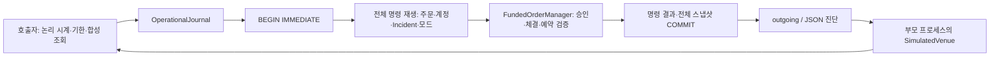

# 운영 제어와 Incident 복구 계약

이 문서의 운영 기능은 **OperationalJournal을 사용하는 합성 OMS 경로**에 적용된다.
기존 FundedJournal은 주문/회계 검증 기능만 제공하며 Incident나 운영 제한을 추가하지 않았다.
코드는 `src/market_microstructure/oms_operations.py`에 있고 주문 상태 머신은 기존 것을 재사용한다.



## 기존 동작과 이번에 추가한 책임

기존 프로토콜은 초과 체결, 체결 ID/보고 ID 충돌, 같은 revision의 모순, 누적 체결 누락,
주문 귀속 변경, 종료 사실 변경을 감지해 거부한다. 후보를 검증한 뒤에만 상태를 바꾸고
SQLite 트랜잭션이 실패하면 명령과 스냅샷을 함께 롤백한다. 잘못된 보고 때문에 예약을 풀지 않는다.
기존 `recover`는 로컬 저널을 검산하고 조회 대상을 반환할 뿐 거래소에 연결하지 않는다.
기존 `reconcile`은 호출자가 공급한 조회를 적용한다. 기존 경로에서는 미해결 주문이 있어도
자금·시세·노출 검사를 통과하면 다른 신규 주문을 승인할 수 있었다.

이번 경로는 같은 저널의 명령 종류와 스냅샷을 확장해 운영 정책을 함께 재생한다.
별도 Incident 저장소나 독립 커밋을 만들지 않았다. 기본 저널에 manager/reducer/schema 선택
지점만 추가하고 트랜잭션·중복 명령·재생 검산·DB 검증 알고리즘은 공유한다.
OperationalJournal과 FundedJournal은 서로 다른 schema이며 서로의 DB를 열지 않는다.
코드 해시가 바뀐 과거 DB는 기존 계약대로 거부한다. 이번 변경도 자동 DB 이관은 제공하지 않는다.

## 운영 모드와 승인

| 모드 | 신규 매수 | 보유 수량 범위 매도 | 기존 체결·취소·조회 |
|---|---|---|---|
| NORMAL | 기존 시세·자금·노출 한도 검사 | 기존 자금/수량 검사 | 허용 |
| RESTRICTED | 거부, outgoing 없음 | 기존 검사 후 허용 | 허용 |
| RECOVERY | 거부, outgoing 없음 | 기존 검사 후 허용 | 허용 |

이 프로젝트는 무차입·공매도 없는 현금 계정이므로 매도는 노출 감소다. 실제 파생계약 계정에
이 규칙을 그대로 적용할 수 없다. 매수 제한도 원래 주문 입력/자금 검증 경로를 거친 뒤
적용하며 실제 예약은 커밋하지 않는다. 거부 결과와 시각은 저널에 남는다.

생성 모드는 RECOVERY다. 비어 있는 검증된 초기 계정은 NORMAL로 전환할 수 있다.
운영 모드는 재시작 후 그대로 복원된다. **DB open은 읽기 검증이며 자동으로 모드를 바꾸지 않는다.**
저수준 저장소를 직접 쓰는 호출자는 재시작 뒤 주문을 받기 전에 `control(..., 'RECOVERY', ...)`를 커밋해야 한다.
대표 데모는 이를 수행한다. 현재 실행 경로는 [TradingSession](FIX_ADAPTER.md)을 사용해 단일 협력 프로세스 락과 자동 RECOVERY를 제공한다.
저수준 저장소 직접 사용·분산 리더 임대·강제 fencing은 해당 보호 범위 밖이다.

RESTRICTED 진입과 명시적 RECOVERY 시작은 조회 검증 epoch를 갱신한다.
NORMAL 전환은 모든 Incident가 RESOLVED이고 모든 등록 주문(종료 주문 포함)에 현재 epoch의
일치 조회 증거가 있어야 한다. 보고 적용/취소/미응답 표시/신규 접수는 해당 주문의 증거를
무효화한다. 따라서 대사 뒤 지연 보고를 받았다면 재조회 후 복귀한다. 시세 검증은 NORMAL
복귀 자체가 아니라 실제 신규 매수 승인 시 수행한다.
모드 전환과 접수는 동일 SQLite writer lock 안에서 직렬화한다. 전환보다 먼저 커밋된 주문은
승인될 수 있다. 이미 반환된 outgoing을 철회하거나 전송 시점까지 차단하는 네트워크 kill switch는 아니다.

## 탐지와 Incident 수명주기

`inspect(command_id, order_id, report, now_ns=..., deadline_ns=...)`는 적용 전 로컬/거래소를
비교하며, `reconcile_at`는 안전하게 적용 가능한 누적 조회를 먼저 반영한 뒤 남은 불일치를 평가한다.
둘 다 단일 명령 트랜잭션이다. `reconcile_at`에서 회계 반영과 Incident 해결이 함께 커밋된다.
기존 무시각 `reconcile` 호출은 운영 경로에서 거부한다.

- `state_mismatch`: 로컬 누적 주문 사실과 조회가 다름.
- `query_unavailable`: 조회 부재. 이것은 거래소 미접수의 증명이 아니다.
- `cancel_unconfirmed`: 사실이 같더라도 취소 결과가 pending/unknown.
- `conflicting_facts`: 형식/주문 귀속 검증은 통과했지만 기존 체결·revision·종료 사실과 모순됨.

전달 지연/조회 부재는 `now_ns < deadline_ns`일 때 일시적 미해결 결과만 반환한다.
기한 이상이면 HIGH Incident와 RESTRICTED를 함께 저장한다. 사실 충돌은 기한 이전에도 즉시
Incident로 기록하며 회계는 건드리지 않는다. 잘못된 형식·다른 주문의 조회는 입력 오류로
거부하고 Incident로 신뢰하지 않는다. 일반 `apply`의 거부도 자동 Incident로 바꾸지 않는다.

기한과 논리 시계는 호출자가 공급한다. 내장 타이머·자동 폴링·네트워크 장애 감지기는 없다.
호출자가 기한을 잘못 정하거나 검사하지 않으면 자동으로 탐지되지 않는다. 논리 시각은
운영 명령/접수 사이에 단조 증가해야 한다. 실제 wall clock 발생 시각이나 외부 시간 동기화를 보장하지 않는다.

Incident는 ID, 발생 시각, 주문 ID/체결 ID, 종류, HIGH 심각도, 최초 로컬/거래소 증거,
원인, OPEN/INVESTIGATING/RESOLVED, 해결 시각/방법/변경 이력을 가진다.
같은 주문+유형의 미해결 사건은 다시 생성하지 않는다. 재탐지 명령/조회 event ID는 저널에
별도로 남고 최초 증거를 덮어쓰지 않는다. 해결 뒤 다시 발생하면 새 사건으로 기록한다.

운영자는 `investigate`에 이유를 남긴다. 일반 미해결 사건은 일치하는 검증된 조회로 해결되며,
사실 충돌은 INVESTIGATING을 거친 후 새 일치 조회가 있어야 해결된다. 임의 RESOLVED API는 없다.
형식이 같은 모의 조회를 누가 공급하는지 인증하지는 않는다. 실제 연결에서는 신뢰할 수 있는
수집 경로·쿼리 신선도·거래소 epoch/sequence 검증이 별도로 필요하다.

## 실행과 진단

```bash
python examples/incident_recovery.py
# DB를 남기려면 존재하지 않는 경로를 지정한다.
python examples/incident_recovery.py --db /tmp/oms-incident.sqlite
python -m market_microstructure.oms_operations /tmp/oms-incident.sqlite --order buy-a
python -m market_microstructure.oms_operations /tmp/oms-incident.sqlite \
  --mode RECOVERY --command-id operator-recovery-1 --now-ns 9 --reason inspect-after-demo
```

JSON 진단에는 모드, 활성/미확정 주문, 계정의 예약·사용 가능 현금, 미해결 사건 수,
마지막 일치 조회, 재검증 대상, 최근 30개 명령/결과가 있다. `--order`는 주문 ID를 정확히
필터링한다. Incident에 대한 investigate 이력도 주문 추적에 포함한다.
`--investigate incident-1 --command-id ... --now-ns ... --reason ...`로 조사 기록을 남길 수 있다.
자동 외부 알림은 보내지 않는다. JSON의 미해결 사건과 ID가 로컬 운영자 진단 인터페이스다.
실패한 트랜잭션의 예외는 호출자에게 전달하며 저널에는 남지 않는다. Incident로 전환된 비교
실패는 정상 커밋된 명령/사건으로 남는다. 별도 에러 수집기는 없다.

대표 시나리오는 현금 1000, 주문 10@100, 수동 체결 4@99 + 3@100, 수수료 0이다.
부모 거래소는 7개 체결/잔여 3 취소인데 클라이언트는 4개 체결/취소 pending인 시점에
SIGKILL한다. 이는 구체적인 누락 응답 경계다. 재시작 직후에는 아직 기한 내이므로 Incident를
만들지 않는다. 기한 5ns까지 불일치가 남으면 관측 증거를 저장하고 신규 위험을 막는다.
조사와 최신 조회로 누락 사실을 반영한 뒤 중복/역순 보고를 다시 보내고 재검증해 NORMAL로
복귀한다. 독립 Decimal 계산은 `1000-4*99-3*100=304`, 보유 7, 예약 0이다.

## 검증·성능·한계

`tests/test_oms_operations.py`는 사건 중복/재시작/해결 이력, 제한 중 체결·취소·매도,
부재 조회 예약 유지, 복귀 거부, 기존 API 우회 거부, 스냅샷 변조 거부, 실제 CLI/데모를 검사한다.
사건 탐지와 대사 각각에서 스냅샷 쓰기 전/후 및 COMMIT 직후 `os._exit`를 주입한다.
두 연결의 실제 writer 경합은 Barrier로 시작시키고 커밋 sequence에 맞는 결과를 검사한다.
이 테스트는 어느 writer가 이길지는 고정하지 않는다. 다른 검증은 결정론적이며 난수는 없다.

매 명령 전체를 재생하므로 Incident 증거와 이력도 저장/재생 비용을 늘린다. 진단도 전체
검증 뒤 최근 30개를 반환하며, 최근 30개만 읽어 검증을 생략하지 않는다. 중복 탐지도 기록되므로
로그는 증가한다. 8MiB JSON 한도·디스크 관리·로그 회전·증거 보존 기간은 운영상 제약이다.
기존 성능 JSON은 각 source SHA의 역사적 측정이며 **새 운영 경로의 성능 수치가 아니다**.
이후 고정 활성 상태의 이력10/50/150/500에서 운영/FIX 경로를 측정했다.
[현재 A/B 근거](OPERATIONAL_EVIDENCE.md)는 과거 JSON과 별도이며 실제 운영 규모·네트워크의
측정은 아니다. 검증 강도를 낮추는 캐시는 추가하지 않았다.

전원 손실, DB 이관, 실제 거래소 API/FIX, 체결 정정, 수수료, 계좌 전체 대사, 멀티 리더,
인증·권한, 알림 전송/승인/재전송, 외부 타이머, 실제 거래소 timeout 적합성은 미검증/미구현이다.
DB 손상/코드 해시 불일치로 저널을 열 수 없으면 같은 저널에 Incident를 저장할 수도 없다.
이는 외부 감시/백업/복원 절차가 필요한 별도 장애다.
